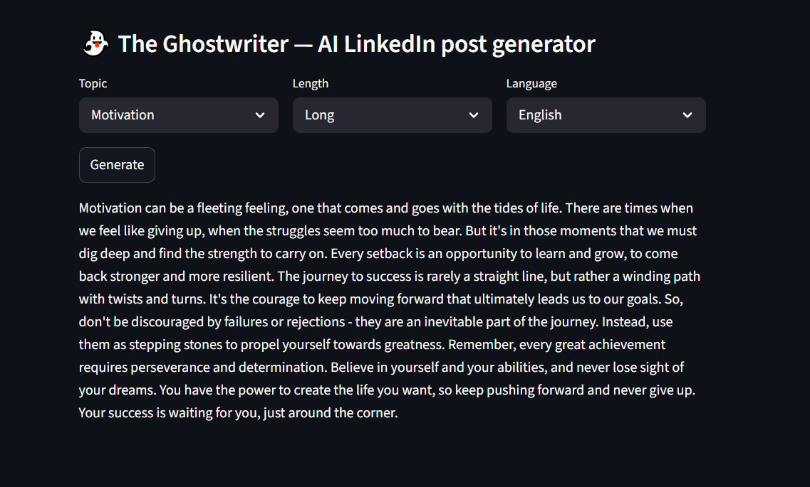
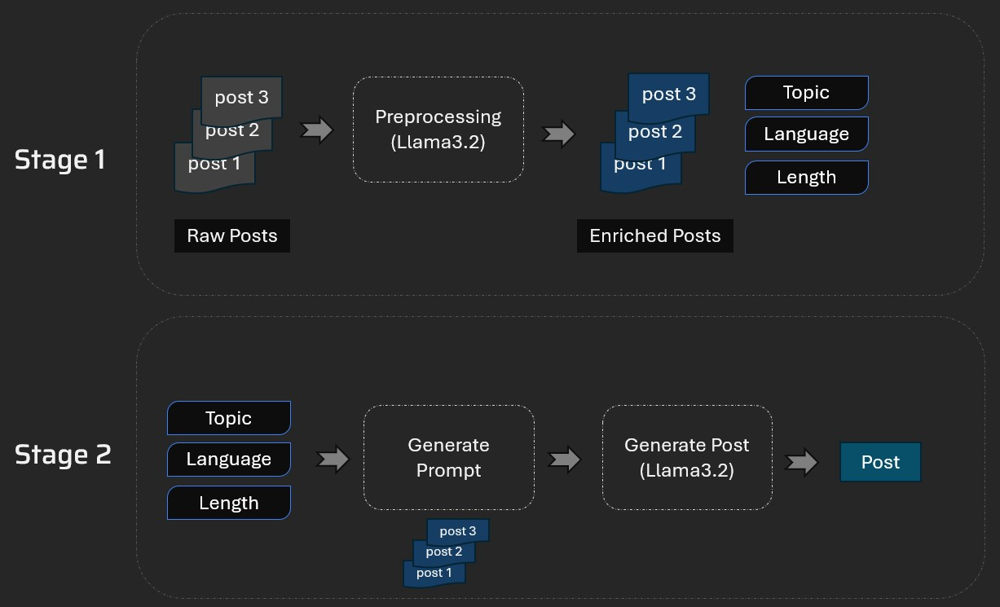

# The Ghostwriter

An AI-powered LinkedIn post generator that learns from your existing posts and writes new ones that match your personal voice, tone, and style.



## What it does

Feed it a collection of your past LinkedIn posts and it will extract topics, detect your writing patterns, and generate fresh content that sounds like you — not like a generic AI.

You pick the topic, length, and language. The app finds your most relevant past posts for that combination and uses them as few-shot examples to guide the LLM, so the output stays true to how you actually write.

## How it works



**Stage 1 — Enrich your data**
Run `preprocess.py` once on your raw posts. It calls the LLM to extract metadata (line count, language, tags) from each post and unifies similar tags into a clean, consistent set. The result is saved to `data/enriched_posts.json`.

**Stage 2 — Generate posts**
The Streamlit app loads the enriched data, lets you choose a topic, length, and language, then builds a prompt with matching style examples and sends it to the LLM.

## Tech stack

| Layer | Tool |
|---|---|
| UI | Streamlit |
| LLM | LLaMA 3.3 70B via Groq |
| Orchestration | LangChain |
| Data | Pandas |

## Setup

1. Clone the repo and install dependencies:
   ```bash
   pip install -r requirements.txt
   ```

2. Copy `.env.example` to `.env` and add your Groq API key:
   ```bash
   cp .env.example .env
   ```
   Get a free key at https://console.groq.com/keys

3. Add your LinkedIn posts to `data/source_posts.json`, then run the preprocessing pipeline:
   ```bash
   python preprocess.py
   ```

4. Launch the app:
   ```bash
   streamlit run main.py
   ```
